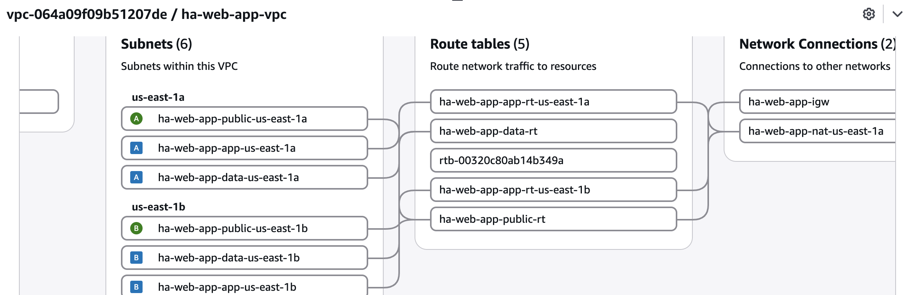

# 01 · Highly available multi-tier web app

> **Status:** ✅ All layers built: network, database, compute, internal load balancer, CloudFront + WAF

## Problem
_A business-critical app must survive the loss of an Availability Zone with no manual intervention._

## Architecture
Viewer → **CloudFront** (HTTPS, AWS WAF) → *VPC origin* → **internal ALB** (private, 2 AZs) → **EC2 Auto Scaling
group** (private app subnets) → **RDS PostgreSQL Multi-AZ** (private data subnets). DB credentials in
Secrets Manager. No SSH; access through SSM Session Manager. **Nothing in the VPC has a public endpoint
except the NAT Gateway, which is outbound only.**

_Diagram: `docs/diagrams/01-ha-web-app.png`_

### Network layout (`10.0.0.0/16`, 2 AZs)

| Tier | AZ a | AZ b | Route to internet | What lives here |
|------|------|------|-------------------|-----------------|
| Public | 10.0.0.0/24 | 10.0.1.0/24 | Internet Gateway | ALB, NAT Gateway |
| App | 10.0.10.0/24 | 10.0.11.0/24 | NAT (outbound only) | EC2 Auto Scaling group |
| Data | 10.0.20.0/24 | 10.0.21.0/24 | None | RDS Multi-AZ |



*Deployed network, from the VPC console's resource map. The unnamed `rtb-…` is the VPC's main
route table. No subnet uses it, so anything accidentally left unassociated gets no internet route.*

Gaps between tiers (`.2`–`.9`, `.12`–`.19`) leave room for a third AZ without renumbering.
VPC Flow Logs (all traffic, 60s aggregation) go to CloudWatch Logs with 7-day retention.
The default security group has no rules.

## Build checklist
- [x] Network module: VPC, 6 subnets across 2 AZs, IGW, NAT, route tables, Flow Logs
- [x] Security groups chained ALB → app → DB
- [x] RDS Multi-AZ + Secrets Manager
- [x] Launch template, instance profile, ASG (min 2 / max 4, target tracking 60% CPU)
- [x] ALB across both public subnets, health checks on `/health` (TLS comes with CloudFront in the next layer)
- [x] CloudFront with a VPC origin to the internal ALB, AWS WAF (managed rules + per-IP rate limit), security headers
- [ ] Failure tests: terminate instances, force RDS failover, load test

## Design decisions & trade-offs
- **One NAT Gateway, not one per AZ.** Saves about $33/month in the lab. Trade-off: if AZ a fails, app
  instances in AZ b lose *outbound* internet, though inbound traffic through the ALB keeps working.
  Production would set `single_nat_gateway = false`. Each AZ already has its own app route table,
  so that switch needs no re-plumbing.
- **Data tier has no internet route at all**, not even through NAT. The database only needs to talk to the app tier.
- **No public IPs auto-assigned in public subnets.** Only the ALB and NAT live there.
- **Security groups reference each other, not IP ranges.** Only members of the ALB group can reach the
  app port, and only members of the app group can reach PostgreSQL. A new instance in the same subnet
  gets nothing by default. The database group has no outbound rules at all.
- **No database password in code or Terraform state.** `manage_master_user_password` has RDS generate the
  password and keep it in Secrets Manager with automatic rotation.
- **RDS Multi-AZ (instance), not Aurora.** `db.t4g.micro` Multi-AZ costs about $0.80/day; the smallest Aurora
  setup costs several times that. Aurora would win on failover time (usually under 30s vs. 1–2 min) and
  read replicas, which matters more in Project 03.
- **`/health` never touches the database.** If it did, a 40-second RDS failover would fail every
  instance's health check at once, and the Auto Scaling group would replace the whole fleet during a
  database blip. `/db` is the separate deep check.
- **No SSH, no key pairs, IMDSv2 only.** Shell access is through SSM Session Manager, which is audited
  and needs no open inbound port. The instance role can read exactly one secret.
- **Graviton (`t4g.micro`) on Amazon Linux 2023.** The AMI comes from AWS's public SSM parameter, so
  every new launch template version picks up the latest patched image. A rolling *instance refresh*
  (at least 50% healthy) replaces instances when the template changes.
- **`desired_capacity` is left unset** so `terraform apply` never undoes a scale-out by the target
  tracking policy.
- **ELB health checks on the Auto Scaling group.** An instance that stops answering `/health` is
  *replaced*, not just pulled from the load balancer. Checks run every 10s; 2 failures mark a target
  unhealthy (about 20s). `deregistration_delay` is 30s instead of the 300s default, so scale-in and
  instance refreshes don't stall.
- **CloudFront VPC origin to an *internal* ALB.** The older pattern is a public ALB restricted to
  CloudFront's IP ranges plus a secret header. With a VPC origin the ALB has no public IP at all;
  CloudFront reaches it over the AWS network through ENIs in the VPC. The ALB's security group has one
  ingress rule: port 80 from AWS's managed `com.amazonaws.global.cloudfront.origin-facing` prefix list
  (which counts as about 55 of the security group's 60 rules).
- **TLS at the edge, no domain needed.** CloudFront's default `*.cloudfront.net` certificate serves
  HTTPS, HTTP redirects to HTTPS, and the `Managed-SecurityHeadersPolicy` adds HSTS,
  X-Content-Type-Options and X-Frame-Options. CloudFront → ALB is HTTP but never leaves the AWS network.
  With a custom domain: ACM certificate in us-east-1 + Route 53 alias.
- **WAF at the edge, not on the ALB.** Blocked requests never reach the VPC. Rules, in order: per-IP
  rate limit (500 requests / 5 min), Amazon IP reputation list, Core Rule Set (OWASP-style), Known
  Bad Inputs (for example Log4Shell). The web ACL is created in us-east-1 through a provider alias,
  since CloudFront-scoped WAF must live there even when the stack runs elsewhere (Project 03).
- **Caching disabled** (`Managed-CachingDisabled`): every response is dynamic. A static-asset
  behavior with caching would be the next step for a real frontend.
- _EC2 vs. ECS Fargate_

## Results
| Test | Measured |
|------|----------|
| App tier reachable via SSM, DB check from both AZs | ✅ 2026-11-06: `/health` ok, `/db` ok (PostgreSQL 17.9, TLS) |
| Instance terminated without warning (2026-11-06) | **96.50%** over a 180 s probe: 276/286 OK. 10 failures (6 × 502, 4 × timeout), all between 14:35:23 and 14:35:41 (about 18 s) and only on requests routed to the dead target. Longest run of consecutive failures: 4 s. |
| Replacement instance | The ASG launched `i-02ef…` in us-east-1b; it passed health checks and served 23 requests before the probe ended. |
| Instance removed gracefully: `terminate-instance-in-auto-scaling-group` (2026-11-06) | **100.00%** over a 180 s probe: 301/301 OK, no failures. The ASG deregistered the target (30 s drain) before stopping it, then launched replacement `i-0cbad…` in us-east-1b, which served 53 requests. |
| RDS forced failover (2026-11-05) | **40 s** per RDS event log (failover started → completed); primary moved us-east-1b → us-east-1a. API status back to `available` after 83 s. |
| Scale-out under load | _ → _ instances |

## Deploy / destroy
```bash
cd 01-ha-web-app
terraform init -backend-config="bucket=bernard-tfstate-40b007"
terraform apply
terraform destroy
```
Destroy at the end of every session; the NAT Gateway, RDS and ALB bill hourly. Destroying takes
15–25 minutes, because CloudFront must disable the distribution and remove the VPC origin's network
interfaces. If it stops with `DependencyViolation` on a subnet or the VPC, CloudFront is still
cleaning up its interfaces: wait 5 minutes and run `terraform destroy` again.

Approximate running cost with everything on: NAT Gateway about $1.20/day, RDS Multi-AZ about $0.90/day,
ALB about $0.55/day, 2 × t4g.micro about $0.40/day, WAF about $0.30/day ($5 per web ACL + $1 per rule
per month, prorated). CloudFront and the VPC origin cost nothing at this traffic level.
**About $3.30/day in total.** Cheaper options while building:
```bash
terraform apply -var="db_multi_az=false"          # single-AZ DB, about half the DB cost
terraform apply -var="enable_nat_gateway=false"   # no NAT; fine until the app tier exists
```

### Check the app tier (before the load balancer exists)
Instances take about 3–5 minutes after `apply` to install packages and register with SSM.
Works in zsh and bash:
```bash
ASG=$(terraform output -raw asg_name)
aws autoscaling describe-auto-scaling-groups --auto-scaling-group-names $ASG \
  --query 'AutoScalingGroups[0].Instances[].[InstanceId,AvailabilityZone,HealthStatus]' --output text
IDS=( $(aws autoscaling describe-auto-scaling-groups --auto-scaling-group-names $ASG \
  --query 'AutoScalingGroups[0].Instances[].InstanceId' --output text) )
CMD=$(aws ssm send-command --document-name AWS-RunShellScript --instance-ids "${IDS[@]}" \
  --parameters 'commands=["curl -s localhost:8080/health; echo; curl -s localhost:8080/db"]' \
  --query Command.CommandId --output text)
sleep 10
for i in "${IDS[@]}"; do
  echo "== $i"
  aws ssm get-command-invocation --command-id $CMD --instance-id $i --query StandardOutputContent --output text
done
```
For an interactive shell: **Systems Manager → Session Manager → Start session**, then pick an instance.
The boot log is in `/var/log/app-bootstrap.log`.

**Result (2026-11-06):** 2 instances (us-east-1a, us-east-1b), both `Healthy`. On both, `/health` returned
`ok` and `/db` returned `"ok": true`, connected over TLS to PostgreSQL 17.9 at `10.0.20.211` (data subnet, AZ a).
First-call latency was about 438 ms, which includes the Secrets Manager fetch and TLS setup. Later calls reuse the cached credentials.

### Open the app
```bash
terraform output -raw app_url
```
Open that `https://….cloudfront.net` URL in a browser and refresh a few times. The instance ID and AZ
change as the load balancer alternates between the two instances. `/db` shows the database check.
The first `apply` takes about 15–25 minutes; the CloudFront VPC origin is the slow part.

### Prove the edge controls
```bash
URL=$(terraform output -raw app_url)
curl -s -o /dev/null -w '%{http_code}\n' "$URL/health"
curl -s -o /dev/null -w '%{http_code}\n' "${URL/https/http}/health"
curl -s -o /dev/null -w '%{http_code}\n' "$URL/?q=<script>alert(1)</script>"
curl -sI "$URL/" | grep -i -E 'strict-transport|x-frame|x-content-type'
curl -s -m 5 "http://$(terraform output -raw alb_dns_name)/health" || echo "ALB unreachable from the internet"
```
Expected: `200`, then `301` (HTTP redirects to HTTPS), then `403` (WAF blocked the XSS), then the
security headers, then "ALB unreachable". The ALB's DNS name resolves to private 10.0.x.x addresses.
Blocked requests appear in **WAF & Shield → Web ACLs → ha-web-app-edge → Sampled requests**
(choose the Global/CloudFront region).

### Availability test: kill an instance
Terminal 1, the probe (2 requests/second for 3 minutes, then a summary):
```bash
./scripts/availability-test.sh
```
Terminal 2, about 20 seconds in, terminate one instance without warning:
```bash
ASG=$(terraform output -raw asg_name)
VICTIM=$(aws autoscaling describe-auto-scaling-groups --auto-scaling-group-names $ASG \
  --query 'AutoScalingGroups[0].Instances[0].InstanceId' --output text)
aws ec2 terminate-instances --instance-ids $VICTIM
```
Watch the ASG launch a replacement in **EC2 → Auto Scaling groups → Activity**, and the new target go
`initial` → `healthy` in **EC2 → Target groups → Targets**. Record the probe's summary below.

**Reading the result.** An unannounced crash is the worst case. The ALB keeps routing some requests to
the dead target until 2 consecutive health checks fail (2 × 10 s), so those requests get `502`
(connection refused during shutdown) and then time out (instance gone). Requests to the healthy
instance keep succeeding the whole time. Ways to shrink the window:
- Faster health checks (5 s interval, threshold 2), so the window is about 10 s
- Planned removals that drain first: `aws autoscaling terminate-instance-in-auto-scaling-group
  --instance-id <id> --no-should-decrement-desired-capacity` deregisters the target before stopping
  it. Measured: **100%** (see Results). Scale-in and instance refreshes take the same draining path.

| Scenario | Availability | Failure window |
|---|---|---|
| Instance crashes without warning | 96.50% | about 18 s, only for requests routed to the dead target |
| Instance removed gracefully (drained first) | 100.00% | 0 s |

### Failover test (RDS)
```bash
DB=$(terraform output -raw db_identifier)
aws rds describe-db-instances --db-instance-identifier $DB \
  --query 'DBInstances[0].[AvailabilityZone,SecondaryAvailabilityZone]'
aws rds reboot-db-instance --db-instance-identifier $DB --force-failover
# re-run describe-db-instances: the two AZs swap
aws rds describe-events --source-identifier $DB --source-type db-instance --duration 30 \
  --query 'Events[].[Date,Message]' --output text
```

The event log is the source of truth for timing. `AvailabilityZone` in `describe-db-instances` can
lag by a minute or two after the failover completes. In the first test it still showed the old AZ
when the status returned to `available`.

| Event (UTC, 2026-11-05) | Time |
|-------------------------|------|
| Multi-AZ instance failover started | 18:03:19 |
| DB instance restarted | 18:03:34 |
| Multi-AZ instance failover completed | 18:03:59 |

This measures the database side only. Real application downtime, including DNS TTL and connection
retries, gets measured once the app tier exists.

Network only, no NAT (nearly free, good for a quick look):
```bash
terraform apply -var="enable_nat_gateway=false"
```
