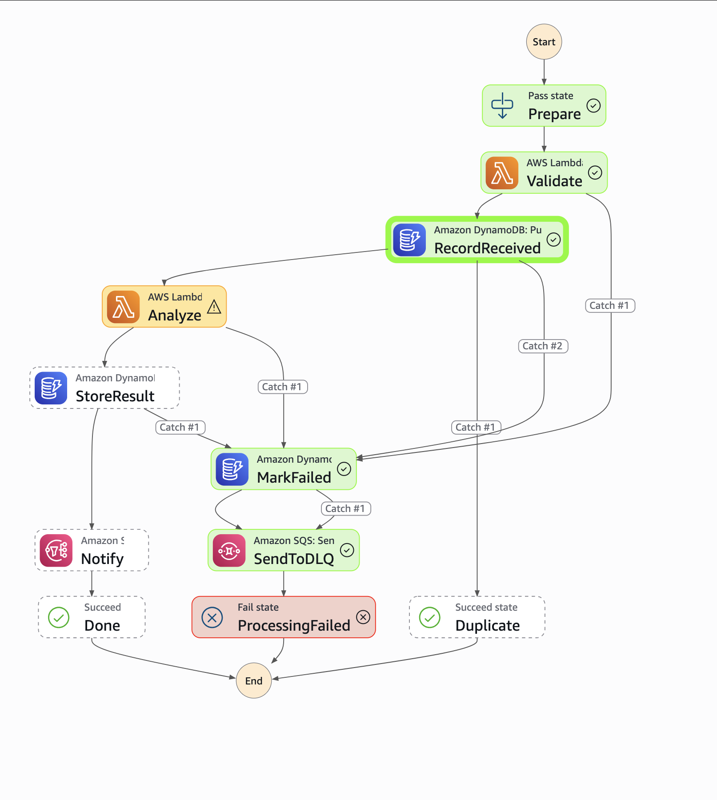

# 02 · Serverless event-driven pipeline

> **Status:** ✅ Complete: pipeline, query API, 500-file burst test and incident drill, all measured

## Problem
_Data center teams export rack inventories as CSV files, and bad rows (duplicate asset tags, missing
serials, two devices in the same rack unit) cause real problems on the floor. Every upload should be
checked automatically, at any burst size, with failures captured instead of lost, and no servers to run._

## Architecture
```
S3 incoming/*.csv ──EventBridge──▶ Step Functions (Standard)
                                   │
                                   ├─ Prepare        Pass: doc_id = key#etag
                                   ├─ Validate       Lambda: type and size (bad files are not retried)
                                   ├─ RecordReceived DynamoDB PutItem, conditional (idempotent)
                                   ├─ Analyze        Lambda: parse CSV, find data-quality issues
                                   ├─ StoreResult    DynamoDB UpdateItem (direct integration)
                                   └─ Notify         SNS Publish (direct integration)
                     any failure ─▶ MarkFailed (DynamoDB) ─▶ SendToDLQ (SQS) ─▶ Fail
                     DLQ depth > 0 ─▶ CloudWatch alarm ─▶ SNS

caller ──SigV4──▶ API Gateway HTTP API (IAM auth, throttled) ──▶ Lambda ──Query──▶ DynamoDB GSIs
```

### What the Analyze step checks
| Check | Example from `samples/rack-inventory-issues.csv` |
|---|---|
| Missing serial number | `DC1-00302 has no serial_number` |
| Two devices in one rack unit | `DC1-00303 and DC1-00302 both in R03 U2` |
| Rack unit outside 1–48 | `DC1-00304 has invalid rack_unit '52'` |
| Unknown status | `DC1-00305 has unknown status 'broken'` |
| Duplicate asset tag | `asset_tag DC1-00301 appears 2 times` |

Decommissioned devices don't count as occupying a rack unit.

## Build checklist
- [x] S3 bucket with EventBridge notifications + rule that starts the workflow
- [x] Step Functions workflow, Lambda steps (Python 3.13, arm64), retries + Catch → DLQ
- [x] DynamoDB (on-demand, GSI on status + created_at, PITR)
- [x] SNS completion topic (optional email) + CloudWatch alarm when the DLQ isn't empty
- [x] Least-privilege role per function, idempotency, X-Ray tracing
- [x] Unit tests: handlers + workflow structure (run in CI)
- [x] API Gateway HTTP API to query results (IAM auth, throttling, access logs, GSI queries only)
- [x] Burst test tooling (500 generated files) and DLQ redrive tool + incident drill

## Design decisions & trade-offs
- **Step Functions direct integrations instead of Lambda glue.** Writing to DynamoDB, publishing to SNS
  and sending to SQS are done by the state machine itself. Only two functions contain real logic, so
  there's less code, fewer cold starts, and one less IAM role per step.
- **Idempotency with a conditional write.** S3 → EventBridge delivery is at-least-once. `doc_id` is
  `key#etag`, and `RecordReceived` uses `attribute_not_exists(doc_id) OR status = FAILED`. A repeated
  event for a file that is `PROCESSING` or `COMPLETE` ends in the `Duplicate` state. A *new version* of
  the file (new ETag), or a DLQ redrive of a `FAILED` one, is processed again.
- **Retry only what can succeed on retry.** Lambda *throttling* gets its own long policy (up to 10
  attempts, each wait capped at 30 s, about 3 minutes worst case), so a burst on an account with low
  Lambda concurrency slows down instead of dead-lettering good files. Other Lambda service errors and
  DynamoDB throttling get short exponential backoff. All retries use full jitter. `ValidationError` and `SchemaError` go straight to the DLQ,
  because a bad file stays bad.
- **Nothing is dropped.** Workflow failures go to the DLQ with full context (event, document, error),
  and the item is marked `FAILED`. EventBridge has its own retry policy and dead-letter config pointing
  at the same queue, in case it can't start the workflow at all.
- **Standard, not Express, workflows.** Standard gives exactly-once execution and a visual history of
  every run, which is useful for audits. Express is cheaper at very high volume (thousands per second)
  but at-least-once.
- **SNS topic not KMS-encrypted.** CloudWatch alarms can't publish to a topic using the AWS-managed
  `alias/aws/sns` key. Production would use a customer-managed key whose policy allows
  `cloudwatch.amazonaws.com`.
- **Query API with IAM (SigV4) auth.** It's an internal operations API, so only identities in this AWS
  account can call it. HTTP APIs don't support API keys, and an external audience would get a Cognito
  JWT authorizer. The route is throttled (10 requests/s, burst 20) and every call is access-logged
  with the caller's ARN.
- **Queries, never scans.** `GET /documents?key=` uses the `by-key` index and `?status=` uses
  `by-status`, both newest first with opaque `next` tokens for pagination. The API returns only
  public fields (no execution ARNs or bucket names) and can only `Query`/`GetItem` this table.
- **Least privilege:** `analyze` can read only `incoming/*`; `validate` reads nothing; the workflow can
  invoke only these two functions and write only to this table, topic and queue. Service roles carry
  `aws:SourceAccount` conditions (confused-deputy protection).

## Run it
```bash
cd 02-serverless-pipeline
terraform init -backend-config="bucket=bernard-tfstate-40b007"
terraform apply
./scripts/run-samples.sh
```
Optional email alerts: `terraform apply -var="notification_email=you@example.com"`, then click the
confirmation link AWS emails you.

Expected:
| File | Status | Why |
|---|---|---|
| `rack-inventory-clean.csv` | `COMPLETE` | 10 rows, 2 racks, 0 issues |
| `rack-inventory-issues.csv` | `COMPLETE` | 8 rows, 5 issues (listed by the script) |
| `not-a-csv.txt` | `FAILED` (`ValidationError`) | 1 message in the DLQ, DLQ alarm fires |

Query the results over the API (SigV4-signed with your current AWS sign-in):
```bash
./scripts/query-api.sh 'status=FAILED'
./scripts/query-api.sh 'status=COMPLETE&limit=5'
./scripts/query-api.sh 'key=incoming/<run>/rack-inventory-issues.csv'
./scripts/query-api.sh --unsigned 'status=FAILED'
```
The last one should return **403**: no credentials, no access.

Watch it run: **Step Functions → State machines → inventory-pipeline → Executions** shows each
run's path through the graph.

## Burst test
```bash
./scripts/burst-test.sh        # 500 files; ./scripts/burst-test.sh 100 for a quick run
```
Generates 500 realistic inventory files (about 15,000 rows across 1–3 racks each; about 1 in 5 with a
planted problem), uploads them in parallel, then reports:
- files **lost** (must be 0) and the status counts
- whether **every planted issue was found** (the generator's count must match the analyzer's)
- time from upload to last result, and per-file latency (p50, p95, max)
- Lambda max concurrency, **throttles** and average duration; Step Functions succeeded/failed
- DLQ depth before and after (must not change: every generated file is valid)

## Incident drill: throttled function → DLQ → fix → redrive
Simulates a real outage: the analyze function can't run, files fail after their retries, and the
on-call engineer fixes the cause and replays the dead-letter queue.

1. **Break it.** Reserved concurrency 0 means every invoke is throttled:
   ```bash
   aws lambda put-function-concurrency --function-name inventory-pipeline-analyze --reserved-concurrent-executions 0
   BUCKET=$(terraform output -raw upload_bucket)
   aws s3 cp samples/rack-inventory-clean.csv s3://$BUCKET/incoming/drill/rack-inventory-clean.csv
   ```
   In **Step Functions → Executions**, the run sits in `Analyze` retrying for about 3 minutes, then
   goes `MarkFailed → SendToDLQ`. The DLQ alarm goes to `ALARM`.

   

   *The drill run on 2026-11-07: `Analyze` used up its throttling retries, and the Catch routed the
   file through `MarkFailed → SendToDLQ → ProcessingFailed`. Nothing was lost.*
2. **Fix it:**
   ```bash
   aws lambda delete-function-concurrency --function-name inventory-pipeline-analyze
   ```
3. **Redrive:**
   ```bash
   ./scripts/redrive-dlq.sh --dry-run
   ./scripts/redrive-dlq.sh
   ```
   The throttled file is replayed (its `FAILED` record may be reprocessed) and ends `COMPLETE`.
   `not-a-csv.txt` is skipped and removed, since replaying an invalid file can't help; its `FAILED`
   record stays in DynamoDB. With the queue empty, the alarm returns to `OK` within a few minutes.
4. **Confirm:** `./scripts/query-api.sh 'key=incoming/drill/rack-inventory-clean.csv'` shows `COMPLETE`.

## Results
| Test | Measured |
|------|----------|
| Sample run (2026-11-06) | ✅ clean → `COMPLETE` (10 rows, 2 racks, 0 issues) · issues → `COMPLETE` (8 rows, **all 5 issues found**) · `.txt` → `FAILED` (`ValidationError`), 1 message in the DLQ |
| Duplicate upload (same key + same content → same ETag) | ✅ execution ended in the `Duplicate` state (`SucceedStateExited Duplicate`); stored result untouched |
| DLQ alarm | ✅ `ALARM` within about 1 minute of the bad file: "1 datapoint [1.0] was greater than the threshold (0.0)" |
| Query API (2026-11-06) | ✅ SigV4-signed → **200** with results and parsed analysis (for example, clean file: 10 rows, 2 racks, 0 issues) · unsigned → **403 Forbidden** |
| Adding the `by-key` GSI to a live table | In-place update, 8 m 37 s (index backfilled before apply returned), 0 resources destroyed |
| Burst: 500 files (2026-11-07) | ✅ **500/500 `COMPLETE`, 0 lost, 0 failed, 89/89 planted issues found**, 14,981 rows. Account Lambda concurrency limit: **10**; analyze peaked at 10 with **13 throttles, all absorbed by the throttling retry policy** (DLQ unchanged). Per-file latency p50 0.33 s · p95 0.50 s · max 3.69 s (a throttled file waiting out its retry). Upload from a home connection took 2 m 15 s; the last result landed about 5 s after the last upload, so the pipeline kept pace and the network was the bottleneck. Average duration: validate 4 ms, analyze 217 ms. |
| Incident drill (2026-11-07) | ✅ analyze set to reserved concurrency 0 at 15:11 UTC → throttling retries used up → `MarkFailed → SendToDLQ → ProcessingFailed`, alarm `ALARM` · fix applied, `redrive-dlq.sh` replayed the file → **`COMPLETE` in 3.9 s** (10 rows, 0 issues) · invalid `not-a-csv.txt` skipped, not replayed · DLQ empty, alarm back to **`OK`** · Found and fixed: the dry run's read hid messages for 60 s, so the real run that followed missed one; dry runs now use visibility timeout 0 |
| Cost per 1,000 documents | **≈ $0.19** (see breakdown below) |

## Cost
**Per 1,000 documents**, from the burst test's measured durations and us-east-1 list prices (approximate):

| Item | Basis | Cost |
|---|---|---|
| Step Functions Standard | 7 state transitions per file × $0.025 per 1,000 | $0.175 |
| DynamoDB on-demand | put + update, plus writes to 2 GSIs (~8 WRU/file) × $0.625 per million | ~$0.005 |
| S3 | 1 PUT + 1 GET per file | ~$0.005 |
| Lambda (arm64) | 2 requests; 4 ms × 128 MB + 217 ms × 256 MB per file | ~$0.001 |
| SNS | 1 publish per file | ~$0.0005 |
| **Total** | | **≈ $0.19** |

About 92% is Step Functions state transitions. At high volume, **Express workflows** (billed per
request and duration, not per transition) would cut that roughly tenfold, at the price of
at-least-once execution and no per-run visual history. At this volume, Standard's auditability wins.

At portfolio volume this is close to free: Lambda, Step Functions (4,000 free state transitions per
month), DynamoDB on-demand and S3 are all billed per request. About 7 transitions per file means
roughly 570 files per month inside the free tier. The DLQ alarm costs $0.10/month. Nothing bills while
idle, so `terraform destroy` is optional here.

## Tests
```bash
python3 -m unittest discover -s 02-serverless-pipeline/tests -v
```
38 tests: the validate and analyze handlers against the sample files; the query API with a fake table
(right index, newest first, internal fields hidden, pagination round-trip, input validation); the DLQ
redrive decisions (replay throttled files with only the original event, never replay invalid files);
and structural checks on the Step Functions definition (every transition valid, every state reachable,
failures routed to the DLQ, validation errors never retried, throttling retry long but bounded, FAILED
items reprocessable, DynamoDB reserved words aliased, no unused expression values).
