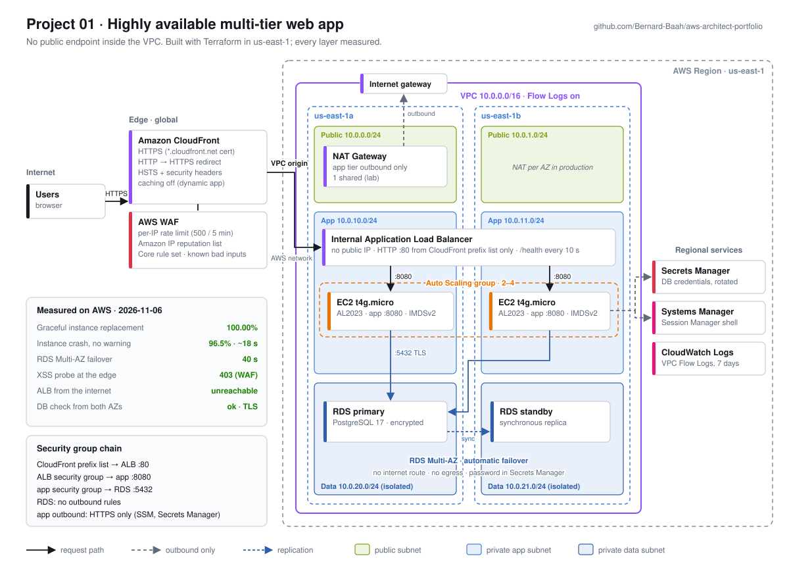
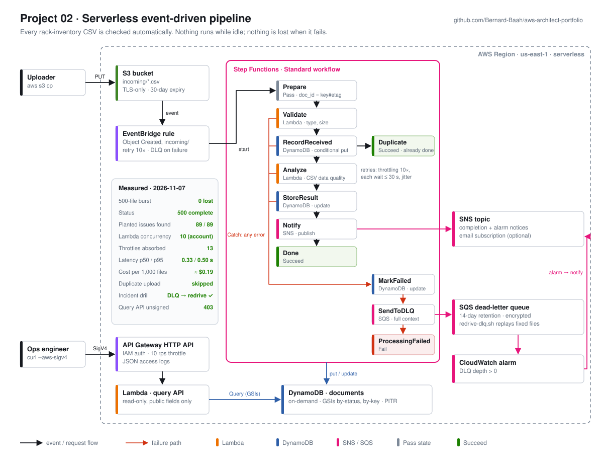

# AWS Solutions Architect Portfolio

Five hands-on AWS projects, built with Terraform, that together form one connected environment:
a highly available app, a serverless pipeline, multi-region disaster recovery, a governed
multi-account landing zone, and full observability with measured cost savings.

Built by **Bernard Baah**, AWS data center infrastructure technician (L3 troubleshooting, rack
deployments, fiber) and AWS Certified Cloud Practitioner. · [bernardbaah.com](https://www.bernardbaah.com)

## Projects

| # | Project | What it proves | Status |
|---|---------|----------------|--------|
| 0 | [Shared setup](00-setup/) | Remote state, CI with OIDC (immutable repo IDs), PR annotations for fmt/validate errors | ✅ Done |
| 1 | [HA multi-tier web app](01-ha-web-app/) | CloudFront + WAF → internal ALB → ASG → RDS Multi-AZ. Measured: 100% availability on graceful replacement, 96.5% on instance crash, 40 s DB failover | ✅ Done |
| 2 | [Serverless event-driven pipeline](02-serverless-pipeline/) | S3 → EventBridge → Step Functions → Lambda/DynamoDB/SNS; IAM-auth query API. Measured: 500-file burst with 0 lost (10-concurrency account, throttles absorbed), ≈ $0.19 per 1,000 files, incident drill DLQ → redrive → alarm OK; 38 unit tests | ✅ Done |
| 3 | [Multi-region disaster recovery](03-multi-region-dr/) | Warm standby us-east-1 → us-west-2: CloudFront origin failover, cross-region RDS replica, password never in state. Game day: **100% availability** through a primary-region outage, **writable in 9 min 15 s** (target 15) | ✅ Done |
| 4 | [Multi-account landing zone](04-landing-zone/) | Organizations, SCPs, central logging, detection | ⏳ Planned |
| 5 | [Observability & FinOps](05-observability-finops/) | SLOs, alarms, tracing, cost optimization | ⏳ Planned |

## Project 01 at a glance

[](01-ha-web-app/)

## Project 02 at a glance

[](02-serverless-pipeline/)

## Repository layout

```
.
├── 00-setup/                 # Account setup + Terraform remote-state bootstrap
├── 01-ha-web-app/
├── 02-serverless-pipeline/
├── 03-multi-region-dr/
├── 04-landing-zone/
├── 05-observability-finops/
├── modules/                  # Reusable Terraform modules shared across projects
├── docs/diagrams/            # Architecture diagrams (draw.io source + PNG exports)
└── .github/workflows/        # Terraform fmt/validate on every pull request
```

## Conventions

- **Everything is code.** Every project deploys with `terraform apply` and is removed with `terraform destroy`.
- **Tags on everything:** `Project=<project-name>`, `Owner=bernard`, `ManagedBy=terraform`.
- **No long-lived keys.** CI assumes an AWS role through GitHub OIDC.
- **Cost guardrails.** A $25/month AWS Budget with alerts; labs are destroyed after each session.

## Each project README covers

1. Problem statement and business scenario
2. Architecture diagram
3. Key design decisions and trade-offs
4. Results with numbers (RTO, latency, cost/month, % saved)
5. Well-Architected pillars addressed
6. Deploy / destroy commands
7. What I'd change for production
